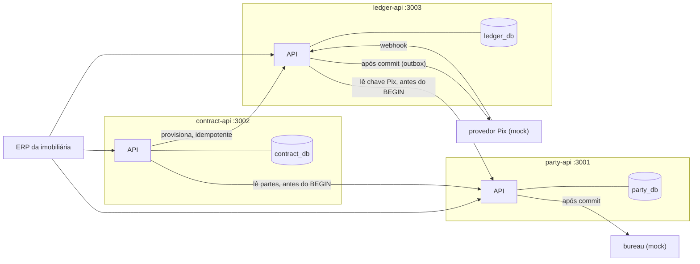
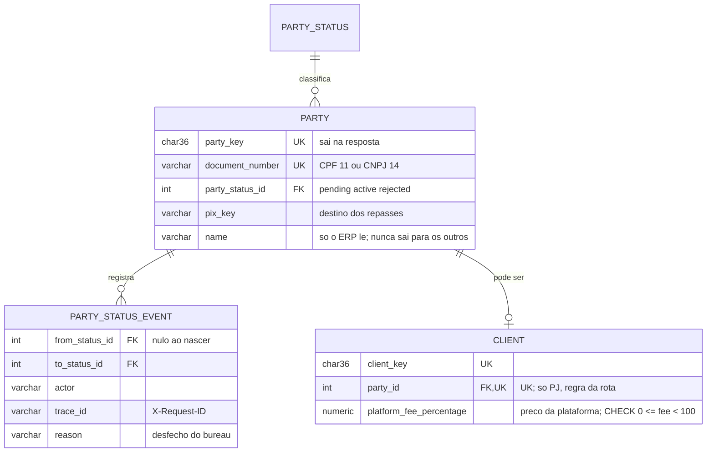
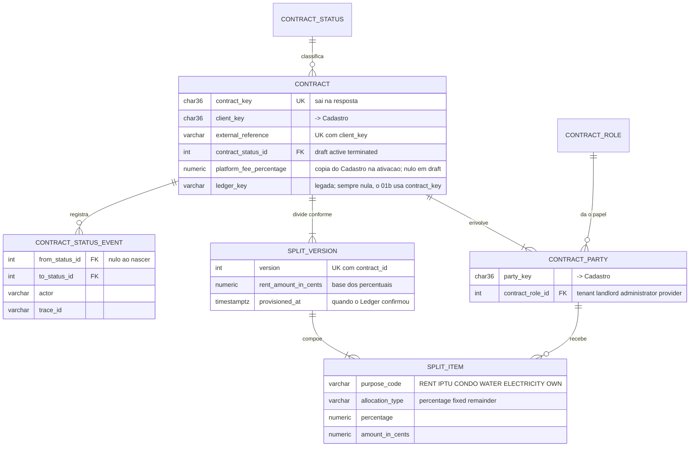
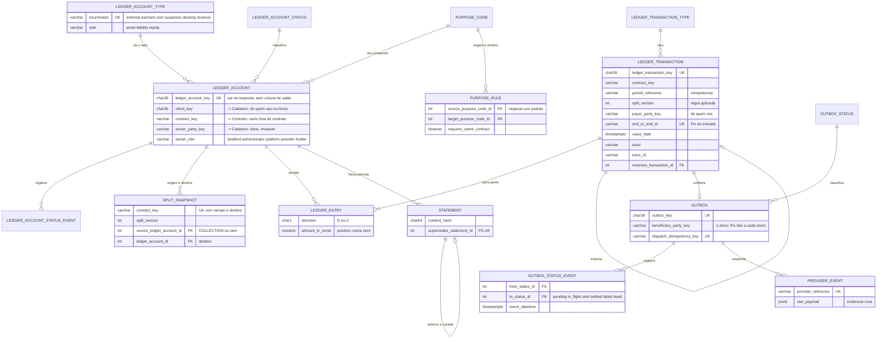
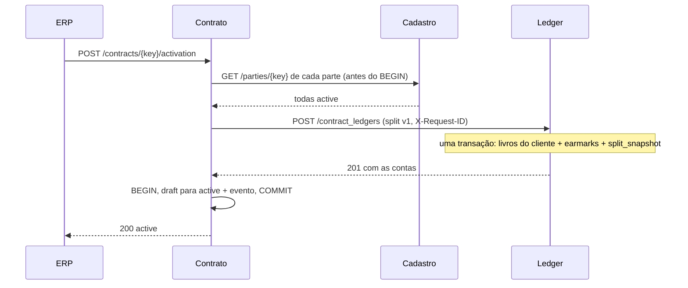

# RFC — Conta com Propósito: contrato como fonte de verdade, ledger carimbado e dinheiro rastreável

| | |
|---|---|
| **Time** | David Aguina · Vinícius Maioral · Ana Aguiar |
| **Data** | 10/10/2026 |
| **Versão** | 2 — três serviços, um ledger; contrato, carteira e rastreio |

## Contextualização

### Entendendo o problema

Imobiliárias, escritórios e ONGs movimentam dinheiro que não é delas. No
caso âncora, o locatário paga um valor só — aluguel, IPTU, condomínio,
água, luz — que precisa chegar, dividido, ao locador, à prefeitura, ao
condomínio, às concessionárias, à imobiliária (taxa de administração) e à
plataforma (taxa paga pela imobiliária). O sistema cadastra pessoas e
empresas, registra o contrato que diz quem recebe o quê, recebe, divide,
repassa a cada dono e mantém carteiras de saldo livre; quem chama é o ERP
do cliente. Quatro garantias: **não-contaminação** (um propósito nunca
paga a despesa de outro, nem sob concorrência), **saldo reconstruível**
(soma de lançamentos imutáveis que fecham em zero), **um evento, um
lançamento** (reenvio não duplica) e **rastreio** (toda movimentação
responde, por consulta, de quem era, por onde passou, para onde foi, para
quem e quando). Se falharem, o aluguel do 101 paga o IPTU do 102, o
extrato deixa de explicar o saldo, o repasse sai em dobro, ou a prestação
de contas vira afirmação. A devolução pelo MED pode deixar uma conta
negativa — estado legítimo, registrado. **Fora do escopo:** KYC real,
cobrança, cartão, crédito, antifraude, login do dono do dinheiro,
agendador, transferência entre carteiras de pessoas.

### Explicando a solução de forma macro

São **três serviços, cada um uma cópia intacta da base, cada um com seu
banco**, e **um único ledger**. O **Cadastro** (`party-api`) guarda
identidades — uma `party` por CPF ou CNPJ — e quem é cliente da
plataforma. O **Contrato** (`contract-api`) é a fonte de verdade de quem
participa de cada locação, em que papel, e de como cada pagamento se
divide (o split, versionado). O **Ledger** (`ledger-api`) é o único lugar
onde dinheiro existe: um sub-razão com seis tipos de conta — `external`
(a conta real), `earmark` (dinheiro de terceiro com propósito), `own`
(recursos livres: a taxa da imobiliária e a carteira de cada pessoa),
`suspense`, `clearing` e `revenue` (a receita da plataforma). Na ativação,
o Contrato manda o Ledger abrir os earmarks do contrato, cada um com
**dono e papel gravados para sempre**, e entrega uma cópia imutável do
split. A partir daí o dinheiro não depende de outro serviço: o pagamento
do locatário entra no earmark `COLLECTION`, uma transação o divide entre
os earmarks e as taxas, e o repasse só sai **para o dono da conta**, por
Pix ou para a carteira dele. Toda operação é uma transação de banco cujos
lançamentos somam zero, trava a conta debitada **antes** de somar o saldo,
e grava quem mandou, por quê e sob qual requisição. Extrato com hash
encadeado, eventos de estado append-only e a rota de rastreio fecham a
auditoria.

**Limites declarados:** consistência eventual entre Contrato e Ledger no
onboarding; pagador declarado pelo ERP, exceto quando paga pela carteira;
linhagem por contrato e competência, não por centavo; um locador por
contrato; encargos variáveis exigem nova versão do split; excedente pago
a mais fica no `COLLECTION` sem rota de devolução; sem conta a receber;
o hash detecta adulteração casual, não a de quem controla o banco.
No Ledger, também: a interna fica fora da cadeia de contrato e
competência do rastreio (S15a D6); a parte que vira `rejected` depois de
abrir a carteira continua recebendo nela, porque o repasse à carteira não
consulta o Cadastro (S12 D2); e a absorção de prejuízo com o `own`
negativo (CU-F8) não tem prova, porque o motor recusa debitar o `own`
além do saldo (`422 QIT001009`; S16 D4).
Ainda no Ledger: o `INTERNAL-TOKEN` é um segredo por serviço, sem
identidade de quem chama (quem age é o `actor` declarado no corpo, que
ninguém confere); o MED que chega depois do encerramento da conta é
recusado com `409 QIT001012` e nada é gravado; não há tradução automática
de código entre serviços (o Ledger devolve só `QIT001…` e reduz a resposta
do Cadastro a `409 QIT001038`, `422 QIT001039` ou `503 QIT001040`; quem
traduz os códigos do Ledger para `QIT003…` é o Contrato, com o código de
origem na descrição); e o MED ou o estorno de um depósito na carteira já
gasto deixa a carteira negativa, porque o estorno não confere saldo, e o
`/integrity` não a aponta, porque há estorno na origem.
No Cadastro: não há `PUT /parties/{key}/pix_key` (a chave Pix só se fixa
no cadastro); `rejected` é terminal; não há estado `inactive` nem
transição de saída de `active`; o `actor` de `POST /clients` vai só para o
log, sem coluna no banco; a `pix_key` com 11 ou 14 dígitos (CPF ou CNPJ
usado como chave) expõe o documento em `GET /parties/{key}`; e a máscara do
log esconde só 11 ou 14 dígitos seguidos, então um documento formatado
(com ponto ou traço) na query string chega ao log como veio — o schema o
recusa, mas a linha de entrada é gravada antes.

Alternativas consideradas e descartadas:

- **Um serviço só, com três domínios** — descartada porque o time divide a
  posse do código por pessoa, e três pessoas no mesmo `app.py` e no mesmo
  `database.sql` disputam os mesmos arquivos. Ganharia em todo critério
  técnico: zero chamada de rede, zero consistência eventual.
- **Ledger dividido entre serviços (earmarks no Contrato)** — descartada
  porque o lock é na linha da conta; com a conta noutro banco, o
  `FOR UPDATE` atravessaria a rede ou deixaria de existir. Ganharia nunca.
- **Coluna de saldo atualizada a cada movimento** — descartada porque é a
  linha que já falhou nesta base: `counter = counter + 1` perdeu de 9 a 23
  de 40 incrementos simultâneos. Ganharia se o volume tornasse o `SUM`
  caro.
- **Dividir na liquidação (split de mercado), sem carimbo** — descartada
  porque não alcança pagamento parcial, retenção nem estorno contra
  destinos já pagos. Ganharia se todas as deduções fossem conhecidas antes
  do recebimento.

## Implementação

### Rotas

Toda rota, menos `/`, `/health_check` e `/statement/verify`, exige o
`INTERNAL-TOKEN` **do serviço chamado** (sem ele, `403 QIT000002`). Toda
rota que muda estado exige `actor` no corpo (ausente, `400 QIT000001`),
com duas exceções no Ledger, que gravam um ator fixo e recusam `actor` no
corpo (`additionalProperties: false`): `POST /outbox/dispatch`
(`ledger-api:dispatcher`) e `POST /webhooks/provider` (`provider`).
Rotas de dinheiro exigem o cabeçalho `Idempotency-Key`, com escopo
*(cliente, rota, chave)* em tabela própria. Os códigos têm faixa por
serviço: `QIT001…` Ledger, `QIT002…` Cadastro, `QIT003…` Contrato. `503`
significa "dependência fora do ar, nada foi gravado, repita".

**Cadastro — `party-api`**

| Método | Caminho | O que faz | Entrada (campos que importam) | Saídas (status e quando) |
|---|---|---|---|---|
| `POST` | `/parties` | Cadastra pessoa física ou jurídica e consulta o bureau após o commit. **Sem duplicar, pela chave natural:** documento único; a repetição dá `409 QIT002003`; a chave se recupera por `GET /parties?document_number=` | `name`, `document_number` (11 ou 14 dígitos), `pix_key` (opcional), `actor` | `201` com `party_key`, `party_type` e `status` (`active`, `rejected`, ou `pending` se o bureau não respondeu); `400 QIT000001`; `409 QIT002003` documento já cadastrado; `422 QIT002002` dígitos verificadores inválidos |
| `GET` | `/parties/{party_key}` | Tipo, estado, chave Pix e se é cliente. **Sem nome e sem documento** | chave | `200`; `404 QIT002001` |
| `GET` | `/parties` | Acha a parte pelo documento (recuperação após timeout) | `document_number` | `200` com zero ou um item; `400 QIT000001` |
| `POST` | `/parties/{party_key}/verification` | Repescagem do bureau. **Idempotente** pela máquina de estados | `actor` | `200`, inclusive se continuou `pending`; `400 QIT000001`; `404 QIT002001`; `409 QIT002004` não está `pending` |
| `POST` | `/clients` | Torna uma pessoa jurídica cliente e fixa o preço da plataforma para ela. **Sem duplicar:** uma por parte; a repetição dá `409 QIT002007`; a `client_key` se recupera em `GET /parties/{key}` | `party_key`, `platform_fee_percentage`, `actor` | `201` com o corpo de `GET /clients/{client_key}`; `400 QIT000001` percentual fora de `^[0-9]{1,2}(\.[0-9]{1,4})?$`, `party_key` fora do UUID v4; `404 QIT002001`; `409 QIT002007` já é cliente; `409 QIT002008` parte não `active`; `422 QIT002006` não é pessoa jurídica |
| `GET` | `/clients/{client_key}` | Cliente, parte e preço da plataforma | chave | `200`; `404 QIT002005` |

**Contrato — `contract-api`**

| Método | Caminho | O que faz | Entrada (campos que importam) | Saídas (status e quando) |
|---|---|---|---|---|
| `POST` | `/contracts` | Cria o contrato em `draft` com participações e split versão 1. **Idempotente pela chave natural:** *(cliente, `external_reference`)* | `client_key`, `external_reference`, `property_reference`, `start_date`, `rent_amount_in_cents`, `parties[]` (`party_key`, `role`), `split[]` (`purpose_code`, `party_key`, `role`, `type`, `value`), `actor` | `201` com `contract_key`; `400 QIT000001` forma, vocabulário, mais de uma `remainder`; `409 QIT003002` referência já usada; `409 QIT003007` cliente não `active`; `422 QIT003004` papéis ausentes ou repetidos; `422 QIT003005` locador = locatário; `422 QIT003006` beneficiário fora do contrato ou no papel errado; `422 QIT003008` cliente inexistente; `422 QIT003011` administradora ≠ cliente; `422 QIT003012` percentuais ≥ 100%; `503 QIT003010` |
| `GET` | `/contracts/{contract_key}` | Contrato, estado, partes e split vigente | chave | `200`; `404 QIT003001` |
| `GET` | `/contracts` | Contratos de uma parte, com o papel dela em cada um; ou o contrato de uma referência do ERP (recuperação após timeout) | `party_key`, ou `client_key` + `external_reference`; `limit`, `page` | `200` paginado (`data`, `limit`, `page`, `is_last_page`); `400 QIT000001` |
| `POST` | `/contracts/{contract_key}/activation` | **Onboarding:** confere as partes no Cadastro, provisiona no Ledger e só então marca `active`. **Idempotente:** já `active` devolve `200`; o Ledger reconhece a versão | `actor`, `reason` | `200`; `404 QIT003001`; `409 QIT003003` encerrado; `409 QIT003007` parte não `active`; `422 QIT003008` parte inexistente; `422 QIT003009` o Ledger recusou o split; `409 QIT003013` conflito de versão no Ledger (código de origem na descrição, nos dois); `503 QIT003010` — continua `draft` |
| `POST` | `/contracts/{contract_key}/split_versions` | Reajuste: nova versão do split, provisionada no Ledger. **Idempotente:** versão não provisionada é reenviada, não duplicada | `rent_amount_in_cents`, `split[]`, `actor`, `reason` | `201` com `version` (e `split_version`, por compatibilidade); `200` quando conclui uma versão pendente reenviada; `404 QIT003001`; `409 QIT003003` contrato não `active`; `422` como em `POST /contracts`; `422 QIT003009`; `409 QIT003013`; `503 QIT003010` |
| `POST` | `/contracts/{contract_key}/termination` | Pede ao Ledger que feche os earmarks e só então marca `terminated` | `actor`, `reason` | `200`; `404 QIT003001`; `409 QIT003003` já encerrado; `409 QIT003013` há saldo retido — continua `active`; `503 QIT003010` |

**Ledger — `ledger-api`**

| Método | Caminho | O que faz | Entrada (campos que importam) | Saídas (status e quando) |
|---|---|---|---|---|
| `POST` | `/contract_ledgers` | *(chamada pelo Contrato)* Abre os livros do cliente se preciso, cria os earmarks do contrato com dono e papel, grava a cópia do split — numa transação. **Idempotente:** *(contrato, versão)* | `contract_key`, `client_key`, `client_party_key`, `split_version`, `rent_amount_in_cents`, `platform_fee_percentage`, `items[]` | `201`; `200` mesma versão, mesmo conteúdo; `409 QIT001032` mesma versão, outro conteúdo; `409 QIT001033` versão fora de sequência; `422 QIT001008` par de propósitos proibido; `422 QIT001028` propósito inexistente; `422 QIT001034` split não fecha: percentuais ≥ 100% do aluguel, ou taxa da plataforma maior que a de administração |
| `POST` | `/contract_ledgers/{contract_key}/closure` | *(chamada pelo Contrato)* Fecha todos os earmarks do contrato, ou nenhum | `actor`, `reason` | `200`; `404 QIT001035` não provisionado; `409 QIT001037` há earmark com saldo |
| `GET` | `/ledger_accounts/{key}` | Conta com saldo **por `SUM`**, dono, papel, propósito, contrato | chave | `200`; `404 QIT001018` |
| `GET` | `/ledger_accounts` | Lista por **um** filtro: `client_key`, `contract_key` ou `owner_party_key` (as contas de uma pessoa) | um filtro, `limit` (≤ 100), `page` | `200` paginado; `400 QIT000001` |
| `PUT` | `/ledger_accounts/{key}/status` | Bloqueia, desbloqueia, encerra | `status`, `actor`, `reason` | `200`; `404 QIT001018`; `409 QIT001043` transição inválida; `409 QIT001037` encerrar com saldo; `409 QIT001011` conta em uso por outra operação, pode repetir |
| `POST` | `/wallets` | Abre a carteira de uma parte nos livros da plataforma. **Idempotente:** uma por parte | `party_key`, `actor` | `201`; `200` já existia; `409 QIT001038` parte não `active`; `503 QIT001040` |
| `POST` | `/transfers/inflow` | **Entrada.** Por Pix: `D external / C COLLECTION` (com contrato), `C carteira` (depósito) ou `C suspense`. Pela carteira: `D carteira / C COLLECTION`, com as pernas entre livros. Grava **de quem era**. **Idempotente:** `Idempotency-Key` | `amount_in_cents`, `value_date`; destino: `contract_key` + `period_reference` + `payer_party_key`, ou `wallet_key`, ou `client_key`; origem: `end_to_end_id` (Pix) ou `source_wallet_key`; `actor` | `201` com `ledger_transaction_key`; `400 QIT000001`; `404 QIT001018` carteira inexistente; `404 QIT001019` cliente sem livros; `404 QIT001035` contrato não provisionado; `409 QIT001010` mesma chave, outro corpo, ou `end_to_end_id` já usado sob outra `Idempotency-Key` (S05a D-01); `409 QIT001011` contenção; `409 QIT001012` conta encerrada; `422 QIT001009` saldo da carteira insuficiente |
| `POST` | `/transfers/split` | **Divisão** de uma competência pela versão vigente do split: `D COLLECTION / C` cada destino, e `D own / C revenue` da taxa da plataforma. Uma transação. **Idempotente:** `Idempotency-Key` + uma por *(contrato, competência)* | `contract_key`, `period_reference`, `value_date` (opcional), `actor`, `reason` | `201` com `split_version`; `400 QIT000001`; `404 QIT001035`; `409 QIT001010`; `409 QIT001011`; `409 QIT001012` destino bloqueado; `409 QIT001036` competência já dividida; `422 QIT001009` o arrecadado não cobre o esperado; `500` Σ ≠ 0, com rollback |
| `POST` | `/transfers/internal` | Movimento manual entre contas: alocar suspense, absorver prejuízo. **Idempotente:** `Idempotency-Key` | `source_account_key`, `gross_amount_in_cents`, `allocations[]` (`percentage` \| `fixed` \| `remainder`), `actor`, `reason` | `201`; `400 QIT000001` mais de uma `remainder`, soma ≠ bruto; `404 QIT001018`; `409 QIT001010/011/012`; `422 QIT001008` par proibido ou contratos diferentes; `422 QIT001009`; `422 QIT001013` livros diferentes; `422 QIT001014` moedas; `500` |
| `POST` | `/transfers/payout` | **Repasse ao dono da conta** — o corpo não tem destino. Pix: `D origem / C clearing` + outbox, despacho após o commit. Carteira: `D origem / C carteira do dono`, liquida na hora. **Idempotente:** `Idempotency-Key` | `source_account_key`, `amount_in_cents`, `destination` (`pix` \| `wallet`), `period_reference`, `actor`, `reason` | `202` (Pix) ou `201` (carteira); `404 QIT001018`; `404 QIT001041` dono sem carteira; `409 QIT001010/011/012`; `409 QIT001038` dono não `active`; `422 QIT001008` a origem não pode repassar (`COLLECTION`, `suspense`); `422 QIT001009`; `422 QIT001039` dono sem chave Pix; `503 QIT001040` Cadastro fora — nada gravado. **`202`, não `502`, quando o provedor não responde:** os lançamentos já foram persistidos |
| `POST` | `/transfers/{key}/reversal` | Estorno total ou parcial; nasce uma transação nova. Aceito em conta `blocked`, também no MED (S11 D-02; S14 RN-05) | `amount_in_cents` (opcional), `actor`, `reason` | `201`; `404 QIT001020`; `409 QIT001011`; `409 QIT001012` conta encerrada (`closed`; `blocked` aceita); `422 QIT001015` estornos excederiam o original; `422 QIT001016` não se estorna estorno; `400 QIT000001` estorno parcial de transação com pernas de valores diferentes (a divisão se estorna inteira e se reparte pela interna) |
| `GET` | `/transfers/{key}/trace` | **Rastreio:** a transação com cada perna (conta, dono, papel, propósito) e a cadeia do mesmo contrato e competência, com os estados do repasse | chave | `200`; `404 QIT001020` |
| `GET` | `/transfers` | Transações por pagador, ou por contrato e competência | um filtro, `limit`, `page` | `200`; `400 QIT000001` |
| `POST` | `/webhooks/provider` | Liquidação confirmada, falha ou MED (pelo `end_to_end_id`). **Idempotente:** `provider_reference` | `provider_reference`, `event_type`, `outbox_key` ou `end_to_end_id`, `value_date` | `204`, reenvio também `204`; `400 QIT000001`; `404 QIT001031` outbox inexistente; `404 QIT001020` entrada desconhecida; `409 QIT001011` repasse ainda em despacho (`pending`/`in_flight`) ou contenção — nada gravado, o provedor repete (S10 D4); outbox `dead` (ou já `settled`/`failed`): `204` sem efeito; MED: `422 QIT001015` acima do que resta da entrada, `409 QIT001012` conta encerrada, nada gravado |
| `POST` | `/outbox/dispatch` | Despacha o que ficou `pending` — rede de segurança | `limit` | `200` com contagens |
| `POST` | `/statement` | Fecha o período de uma conta e emite extrato com hash encadeado. **Idempotente:** `Idempotency-Key` | `ledger_account_key`, `period_start`, `period_end`, `actor` | `201` com `content_hash`; `404 QIT001018`; `409 QIT001017` período já emitido |
| `GET` | `/statement/{key}` | Linhas do período, saldo e hash. Cada linha traz `id` (o `ledger_entry.id`, 1º campo do hash), para que um terceiro recalcule o `content_hash`: hash do anterior por `GET` do `previous_statement_key`, linhas em ordem `(value_date, id)` | chave | `200`; `404 QIT001022` |
| `POST` | `/statement/verify` | **Pública.** Diz se o hash bate; nunca devolve dado pessoal | `content_hash` | `200` com `match` (hash malformado: `match: false`); `400 QIT000001` corpo fora do schema (S13 D-01). **Limite (L23):** a isenção de token vale para o caminho, não para o verbo, então `GET /statement/verify` sem token cai em `GET /statement/{key}` com a chave `verify` e responde `404 QIT001022`; e a rota pública não gera a linha de log de requisição (só a de acesso do uvicorn) |
| `GET` | `/integrity` | `Σ ativo − Σ passivo − Σ patrimônio`, geral ou de um livro, e contas negativas sem estorno na origem. **Limite:** CU-H3 sem caminho HTTP; a lista de suspeitos só se prova vazia (S06, S L5) | `client_key` (opcional) | `200` |

### Banco de Dados (Somente diagrama)

### Fluxos

**Onboarding do contrato — caminho feliz**

1. O Contrato confere no Cadastro que cliente e partes estão `active`,
   **antes** de abrir transação. Parte inexistente é `422 QIT003008`; não
   ativa, `409 QIT003007`.
2. Chama o Ledger com o split inteiro e o mesmo `X-Request-ID` que
   recebeu. O Ledger, numa transação, cria os cinco livros do cliente (se
   ainda não existem), **um earmark `COLLECTION` e um por propósito do
   split** — cada um com `owner_party_key` e `owner_role` do beneficiário
   —, confere cada par na `purpose_rule` e grava a cópia da versão. Cada
   conta nasce com um evento de estado.
3. **Só depois do `201`**, o Contrato grava `active` e o evento. Contrato
   ativo sem conta no ledger é impossível.

**Onboarding — falha: o Ledger não responde**

1. O connector estoura o timeout. O Contrato **não** muda de estado e não
   grava evento; responde `503 QIT003010`.
2. O Ledger pode ter gravado e a resposta ter se perdido. O ERP repete a
   ativação; o Ledger reconhece *(contrato, versão)* e devolve `200` com
   **as mesmas contas**; o Contrato vira `active`. A dúvida do timeout se
   resolve repetindo, sem transação distribuída.

**O aluguel do mês — caminho feliz** (contrato 42: aluguel 500000,
taxa de administração 10%, IPTU 30000, condomínio 80000, água 12000, luz
18000; a Alfa paga 1% de taxa à plataforma)

1. **Entrada:** `POST /transfers/inflow` com contrato 42, competência
   `2026-09`, pagador Bruno, `end_to_end_id` do Pix. `D EXT-ALFA 640000 /
   C C42-COLLECTION 640000`.
2. **Divisão:** `POST /transfers/split`. Trava `C42-COLLECTION`, confere
   que a competência não foi dividida, soma, e posta **uma transação com
   nove lançamentos**: `D COLLECTION 640000`; `C RENT (Ana) 450000`,
   `C own (Alfa) 50000`, `C IPTU 30000`, `C CONDO 80000`, `C WATER 12000`,
   `C ELECTRICITY 18000`; `D own (Alfa) 5000 / C revenue (plataforma)
   5000`. Grava `split_version = 1`. Confere `Σ = 0` no todo e em cada
   livro antes do commit.
**Repasse por Pix — caminho feliz**

1. `POST /transfers/payout` de `C42-RENT`, 450000. **O corpo não tem
   destino:** é Ana porque Ana é a dona da conta.
2. Antes do `BEGIN`, lê no Cadastro que Ana está `active` e a chave Pix
   dela. Cadastro fora do ar → `503 QIT001040`, nada gravado.
3. Trava `C42-RENT`, soma, posta `D RENT / C CLR-ALFA` e grava a outbox
   `pending` na mesma transação. Commit.
4. Marca `in_flight` (commit), chama o provedor com timeout e a
   `dispatch_idempotency_key`; aceito → `sent`. Responde `202`.
5. O webhook de liquidação posta `D CLR-ALFA / C EXT-ALFA` e leva a outbox
   a `settled`. Cada transição da outbox grava evento com o instante.

**O aluguel do mês — falha: pagamento parcial**

1. Bruno paga 320000. A entrada é aceita: `C42-COLLECTION = 320000`.
2. A divisão trava a conta, soma, e o arrecadado não cobre os 640000
   esperados: `422 QIT001009`. Nada é dividido, nada é travado depois do
   rollback.
3. Quando o restante chega, a divisão passa. Dividir proporcionalmente
   um pagamento parcial foi descartado: o contrato não diz qual
   propósito tem prioridade.

**Repasse — falha: o provedor não responde**

1. Os lançamentos e a linha de outbox já foram persistidos; o dinheiro
   está em `clearing`.
2. O timeout volta a outbox a `pending` e incrementa `attempt_count`;
   cada transição grava evento. A resposta continua `202` — `502` diria
   que nada aconteceu, e seria falso.
3. `POST /outbox/dispatch` despacha depois, com a mesma
   `dispatch_idempotency_key`. Esgotadas as tentativas, `dead`; o operador
   estorna o repasse e o dinheiro volta ao earmark.

**Carteira — receber e pagar**

1. Ana recebe na carteira: `POST /transfers/payout` com `destination:
   wallet`. A transação tem quatro pernas: `D C42-RENT / C WAL-ANA`
   (propósito) e `D EXT-PLAT / C EXT-ALFA` (o dinheiro muda de conta
   real). **Cada livro fecha em zero**; `201`, sem outbox.
2. Ana paga o aluguel do contrato 57 com a carteira: `POST
   /transfers/inflow` com `source_wallet_key`. Trava a carteira, soma,
   posta `D WAL-ANA / C C57-COLLECTION` e as pernas entre livros. O
   pagador é **o dono da carteira** — verificado, não declarado.
3. **Falha:** saldo insuficiente na carteira → `422 QIT001009`; dois
   pagamentos simultâneos que juntos estourariam → um passa, o outro
   recebe `422 QIT001009`.

**MED depois do repasse**

1. O webhook `med_return` traz o `end_to_end_id` da entrada. O Ledger acha
   a transação original e posta o estorno `D C42-COLLECTION / C EXT-ALFA`,
   sem passar pela `purpose_rule`.
2. `C42-COLLECTION` fica negativo — legítimo, porque há estorno na origem;
   a integridade não o lista como suspeito.
3. Quem absorve é decisão registrada: a Alfa devolve a taxa com
   `POST /transfers/internal` (`own → COLLECTION`). A taxa da plataforma
   **não** volta automaticamente; a plataforma pode devolvê-la à Alfa pelo
   par `PLATFORM_FEE → OWN`.

**MED — falha: o webhook chega duas vezes, ou cita entrada desconhecida**

1. O mesmo `provider_reference` de novo: `provider_event` tem `UNIQUE`; o
   `INSERT` colide, nada é postado, a resposta é `204` como da primeira
   vez.
2. `end_to_end_id` que nenhuma entrada tem: `404 QIT001020`, nada postado
   — devolução de um dinheiro que nunca entrou não pode virar lançamento.

> ## Principal desafio
>
> - **Qual é:** garantir que nenhuma conta com dono — o aluguel do
>   locador, o IPTU da prefeitura, a carteira de uma pessoa — pague mais
>   do que tem quando vários débitos chegam ao mesmo tempo: duas divisões
>   da mesma competência, dois repasses do mesmo aluguel, dois pagamentos
>   com a mesma carteira. E que a recusa diga o motivo certo: competência
>   já dividida, propósito violado e saldo insuficiente são três erros,
>   não um.
> - **Por que é difícil:** a solução óbvia — somar os lançamentos,
>   conferir e gravar — tem uma janela entre a soma e a gravação, e nela
>   outra requisição soma o mesmo número; as duas aprovam. **Nesta base
>   isso está medido:** o `increment_counter` perdeu de 9 a 23 de 40
>   incrementos simultâneos, com as 40 respondendo sucesso. E a tabela de
>   lançamentos é append-only: não há linha nela para travar.
> - **Como o desenho resolve:** a trava é na linha de `ledger_account`
>   **cujo efeito líquido na transação é débito**, com
>   `SELECT … FOR UPDATE` **antes** do `SUM`; soma e gravação acontecem na
>   mesma transação, e a trava só cai no commit. Mais de uma conta
>   debitada → travas em ordem crescente de `id`, o que torna deadlock
>   impossível. `lock_timeout` de sessão: quem espera demais recebe
>   `409 QIT001011`. A `purpose_rule` é conferida **antes** da trava
>   (`422 QIT001008` sem disputar a linha); a competência já dividida,
>   **depois** da trava e **antes** do `SUM` (`409 QIT001036`, não
>   `422 QIT001009`). Um índice único por *(contrato, competência)* é a
>   rede de segurança.

## Acréscimos à base

A base não é alterada: nenhuma linha dela é mudada ou removida, e as dez
pastas de `src/` ficam como estão. Rotas, erros, tabelas e geradores de
teste entram na anatomia que a base já tem. Toda peça **além** disso vem
justificada abaixo, em quatro linhas: o princípio da base que ela toca, por
que não funciona sem ela, por que é a menor possível e o que ela não faz.
O mesmo texto está no README de cada serviço (§9), ou no guia do serviço
quando a pessoa 1 decidiu manter o registro lá (Cadastro:
`guia-party-api.md` §14, decisão C7 do sumário), e na spec da fatia.

### Ledger

**Os mocks (`party-mock` e `provider-mock`, no `docker-compose.yml`).**

1. *Princípio da base tocado:* o compose da base sobe só `api` e `db`.
2. *Por que não funciona sem:* os testes de integração falam HTTP com a
   API, e a API chama o Cadastro e o provedor Pix; sem mock, nenhum teste
   roda sem os três serviços de pé.
3. *A peça, e por que é a menor:* um container WireMock por dependência,
   configurado só por arquivos JSON — zero código.
4. *O que ela não faz:* não roda em produção, não guarda estado entre
   execuções, não substitui o teste ponta a ponta.

**O erro gravado pela chave de idempotência (`PostingController.post`).**

1. *Princípio da base tocado:* erro previsto não grava nada, e o controller
   só commita depois que a regra passou.
2. *Por que não funciona sem:* a mesma `Idempotency-Key` tem de devolver o
   mesmo erro. Sem o erro gravado, a repetição — ou a requisição que
   esperava no `INSERT` da mesma chave — roda o motor de novo e pode
   responder outra coisa.
3. *A peça, e por que é a menor:* um `SAVEPOINT` logo depois do registro da
   chave. No erro, `ROLLBACK TO SAVEPOINT` desfaz só o movimento; o registro
   recebe o status e o código; e o commit é o da mesma transação, sem
   sessão nova nem segundo commit.
4. *O que ela não faz:* não grava falha de schema, o `QIT001035`, o
   `QIT001019` (S05b D-01) nem o `QIT001018` da conta de origem ou de
   destino de `/transfers/payout` e `/transfers/internal` e da conta de
   `/statement`, nem o `QIT001020` do estorno (transação inexistente) e do
   MED (`end_to_end_id` desconhecido) (que saem antes do registro; S09 D-01,
   S15a D-01, S13 RN-04, S11 D-01),
   não grava erro do webhook do provedor (que é idempotente pelo
   `provider_event` e desfaz tudo no erro, para o provedor repetir),
   não grava movimento pela metade, não tenta de novo e não guarda a
   `description` dinâmica do erro.

**A trava de uma linha nos testes (`DbUtils.hold_row_lock`).**

1. *Princípio da base tocado:* o `db_utils` dos testes só zera o banco;
   nunca monta cenário.
2. *Por que não funciona sem:* a ordem "entrada passa a conferência de
   status → encerramento commita → entrada grava" não se produz por HTTP;
   threads simultâneas só a sorteiam, e sem ela a reconferência de status
   do encerramento não tem teste que falhe.
3. *A peça, e por que é a menor:* trava **uma** linha de `ledger_account`,
   em conexão própria, pelo tempo de um `with`; não muda nada, e o
   `ROLLBACK` a solta.
4. *O que ela não faz:* não escreve (`INSERT`, `UPDATE`, `DELETE`), não
   executa SQL livre, não lê dado para asserção, não monta cenário — o
   cenário nasce por `POST`.

A mesma peça prova o `409 QIT001011` da divisão (fatia 07): o teste segura a
`COLLECTION` com `hold_row_lock` além do `lock_timeout` (S07 D-01).

**Os connectors do Cadastro e do provedor (`PartyConnector`, `ProviderConnector`).**

1. *Princípio da base tocado:* a base só tem o `bankslip_connector`, fora
   de qualquer fluxo.
2. *Por que não funciona sem:* o Ledger não guarda chave Pix — ela vem do
   Cadastro a cada repasse — e o Pix só sai pelo provedor.
3. *A peça, e por que é a menor:* duas subclasses de `RestConnector`, um
   método cada, com timeout vindo do ambiente: o padrão que a base já
   ensina.
4. *O que ela não faz:* transforma só a falha de rede em `None`; não
   interpreta status, não tenta de novo, não guarda chave, não abre
   transação.

**A outbox com despacho inline (`POST /transfers/payout` por Pix).**

1. *Princípio da base tocado:* a base faz um commit, na última linha do
   controller.
2. *Por que não funciona sem:* chamar o provedor dentro da transação
   prende a trava da conta durante a chamada de rede; commitar e chamar
   sem outbox perde o repasse se o processo cair entre os dois; e ler o
   dono da conta no banco antes de chamar o Cadastro já abre uma
   transação.
3. *A peça, e por que é a menor:* a outbox gravada no mesmo commit das
   pernas, mais dois commits de estado (`in_flight`, resultado) e o commit
   que fecha a leitura: quatro commits numa requisição, sem fila nem
   agendador.
4. *O que ela não faz:* não reenvia nem marca `dead` (isso é da fila,
   abaixo), não tem backoff, não liquida, e não segura trava durante a
   chamada externa. Com a fila, o despacho reivindica a linha antes de
   enviar e pode voltar sem despachar, se outro já a reivindicou.

**A trava da transação original nos testes (`DbUtils.hold_transaction_lock`).**

1. *Princípio da base tocado:* o `db_utils` dos testes só zera o banco;
   nunca monta cenário.
2. *Por que não funciona sem:* a trava da transação original só decide a
   corrida entre estornos quando nenhuma conta os ordena antes; por HTTP, a
   `COLLECTION` já os ordena, e só o estorno sem conta travável (uma
   liquidação) a exporia, e apenas por sorteio — sem a peça, essa regra não
   tem teste que falhe de forma determinística.
3. *A peça, e por que é a menor:* trava **uma** linha de
   `ledger_transaction`, em conexão própria, pelo tempo de um `with`; o
   `ROLLBACK` a solta.
4. *O que ela não faz:* não escreve, não executa SQL livre, não lê dado
   para asserção, não monta cenário — o cenário nasce por `POST`.

**A fila de redespacho (`POST /outbox/dispatch`).**

1. *Princípio da base tocado:* a base faz um commit, na última linha do
   controller.
2. *Por que não funciona sem:* o repasse que ficou `pending` por queda ou
   falha do provedor nunca sairia.
3. *A peça, e por que é a menor:* uma tentativa por linha, com dois
   commits (`in_flight`, resultado), reivindicando a linha com `SKIP
   LOCKED` — a linha travada por outro é pulada — e marcando `dead` ao
   esgotar o `OUTBOX_MAX_ATTEMPTS`; disparada por rota, sem agendador.
4. *O que ela não faz:* não tem backoff nem relógio, não estorna o `dead`
   (o operador estorna pela rota de estorno), não tira linha de
   `in_flight` e não segura trava durante a chamada externa.

**A trava de uma linha da outbox nos testes (`DbUtils.hold_outbox_lock`).**

1. *Princípio da base tocado:* o `db_utils` dos testes só zera o banco.
2. *Por que não funciona sem:* duas reivindicações simultâneas da mesma
   linha não se produzem por HTTP de forma determinística; sem a peça, o
   `SKIP LOCKED` não tem teste que falhe.
3. *A peça, e por que é a menor:* trava uma linha de `outbox`, em conexão
   própria, pelo tempo de um `with`; o `ROLLBACK` a solta.
4. *O que ela não faz:* não escreve, não executa SQL livre, não lê dado
   para asserção, não monta cenário.

**O aceite temporário no mock do provedor (`RequestGenerator.accept_pix`).**

1. *Princípio da base tocado:* o mock responde fixo por chave Pix.
2. *Por que não funciona sem:* nenhum mock falha e depois aceita, e o
   despacho tardio pela fila precisa ser provado.
3. *A peça, e por que é a menor:* um mapeamento, para uma única chave de
   despacho do teste, criado pela API de administração do mock e apagado
   ao fim do teste.
4. *O que ela não faz:* não altera arquivo de mock, não persiste e não
   afeta outra chave.

*(A fatia 14 foi integrada em 2026-10-11: estes três blocos e a frase
sobre a fila acima valem como estão.)*

*(As quatro peças a seguir são do ponto de integração contra o Cadastro
de verdade, `tests/e2e/`; ver `specs/ledger-api/handoff-p1-chaves-magicas.md`.)*

**A trava `E2E=1` do ponto de integração (`tests/e2e/conftest.py`).**

1. *Princípio da base tocado:* a suíte da base roda inteira com um
   `pytest`, sem variável nenhuma.
2. *Por que não funciona sem:* os testes de `tests/e2e/` falam com o
   Cadastro de verdade, que o `pytest` comum não tem de pé; sem a trava, a
   suíte contra os mocks falharia por um motivo que não é dela.
3. *A peça, e por que é a menor:* um `pytest_collection_modifyitems` que
   marca como `skip` tudo em `tests/e2e/` quando `E2E` não vale `1`.
4. *O que ela não faz:* não pula nada fora de `tests/e2e/`, não sobe o
   Cadastro e não troca o `PARTY_API_URL` da API.

**O marcador `destrutivo` (`tests/e2e/conftest.py`).**

1. *Princípio da base tocado:* todo teste da base pode rodar junto de
   qualquer outro.
2. *Por que não funciona sem:* o caso "Cadastro fora do ar" para o
   container do Cadastro; rodando junto de outro teste, derruba esse outro.
3. *A peça, e por que é a menor:* um marcador registrado no
   `pytest_configure`; o teste marcado só roda com `E2E_DESTRUTIVO=1` a
   mais, e rodá-lo sozinho fica por conta de quem roda.
4. *O que ela não faz:* não isola nada por conta própria: quem garante que
   nada mais depende do Cadastro naquele momento é quem roda.

**As partes reais do ponto de integração (`tests/utils/party_scenarios.py`).**

1. *Princípio da base tocado:* o cenário nasce por `POST` na própria API, e
   as chaves das partes são as mágicas do `party-mock`.
2. *Por que não funciona sem:* as chaves mágicas (`2222…`, `aaaa…`, `dddd…`,
   `eeee…`, `ffff…`) não existem no Cadastro de verdade.
3. *A peça, e por que é a menor:* `seed_party_scenarios()` cria cada papel
   por `POST /parties` no Cadastro real e devolve `{papel: party_key}`; a
   fixture `party_scenarios` semeia uma vez por `pytest`.
4. *O que ela não faz:* não roda contra o `party-mock` (recusa, se o
   `PARTY_API_URL` tiver o host `party-mock`), não apaga as partes que cria e não
   muda os testes contra os mocks.

**O Cadastro fora do ar de verdade (`tests/e2e/test_party_api_down.py`).**

1. *Princípio da base tocado:* teste fala HTTP com a API e não mexe em
   container.
2. *Por que não funciona sem:* o `cccc…` do `party-mock` simula o Cadastro
   fora do ar com um atraso; contra o Cadastro real, a única forma de
   prová-lo é o serviço estar fora do ar.
3. *A peça, e por que é a menor:* um teste que dá `docker compose stop` no
   container `api` do Cadastro (a pasta vem de `PARTY_COMPOSE_DIR`; sem
   ela, `../BootCamp_QiTech_Party`), exige `503 QIT001040` sem conta gravada e o
   sobe de volta no `finally`.
4. *O que ela não faz:* não roda sem `E2E=1` e `E2E_DESTRUTIVO=1`, não
   para o banco do Cadastro e não termina antes de o `/health_check` dele
   responder de novo, ou de 60 s se passarem (e aí falha).

### Cadastro

- `flake8==7.4.1` — ver `guia-party-api.md` §14
- `bureau-mock` — ver `guia-party-api.md` §14
- bloco de portas do `.env.example` — ver `guia-party-api.md` §14
- métodos de `tests/utils/db_utils.py` — ver `guia-party-api.md` §14
- `is_valid_cnpj` — ver `guia-party-api.md` §14
- `BureauConnector` — ver `guia-party-api.md` §14
- `DocumentMaskFilter` — ver `guia-party-api.md` §14
- `BureauMock` (`tests/utils/bureau_mock.py`) — ver `guia-party-api.md` §14
- `PartyApiMocks` (`tests/utils/party_api_mocks.py`) — ver `guia-party-api.md` §14
- `extra_hosts` no serviço `api` do compose — ver `guia-party-api.md` §14

### Contrato

As quatro linhas de cada peça estão no README do Contrato, §9
(`BootcampQITech-APIContractor-/README.md`, "Acréscimos à base"):

- `party-mock` e `ledger-mock` no compose — ver README do Contrato §9
- trava consultiva por contrato (`ContractRepository.advisory_lock()`) — ver README do Contrato §9
- várias transações por requisição (`ContractController._transaction`) — ver README do Contrato §9
- coluna `contract.platform_fee_percentage` — ver README do Contrato §9
- coluna legada `contract.ledger_key` — ver README do Contrato §9
- `SchemaHandler.validate_payload` — ver README do Contrato §9
- `database/prepare.py` e `scripts/*.ps1` — ver README do Contrato §9
- `tests/utils/docker_environment.py` e `tests/utils/wiremock.py` — ver README do Contrato §9
- `tests/utils/contract_database.py` — ver README do Contrato §9
- `pytest.ini` — ver README do Contrato §9
- `reconfigure` do log para UTF-8 (`src/utils/logger.py`) — ver README do Contrato §9

O que a implementação fixou, além das rotas acima:

- **`POST /contracts/{contract_key}/split_versions` responde `version` e
  `split_version`**, com o mesmo valor. `version` é o campo desta RFC;
  `split_version` fica por compatibilidade com quem já lia a resposta
  igual à da ativação.
- **`GET /contracts` responde no envelope `data`, `limit`, `page`,
  `is_last_page`**, o mesmo da base e do Ledger. A chave antiga
  `contracts` saiu: é mudança incompatível para quem a lia.
- **Chave que não é UUID v4, em qualquer rota `/contracts/{contract_key}`,
  responde `404 QIT003001`.** Esta RFC só prevê `200` e `404` para a
  chave: uma chave malformada não nomeia contrato nenhum, e não chega ao
  banco nem às dependências.
- **`409 QIT003013` também nasce no próprio Contrato**, sem chamar o
  Ledger: quando uma versão de split pendente (não provisionada) é
  reenviada com corpo diferente. É o mesmo conflito que o Ledger
  devolveria como `409 QIT001032` (mesma versão, outro conteúdo), que o
  01b §3 traduz para `QIT003013`. A `description` diz que a versão
  pendente foi reenviada com conteúdo diferente, sem atribuir o conflito
  ao Ledger.
- **`contract.platform_fee_percentage`** (`NUMERIC(7,4)`, nula até a
  ativação) guarda a taxa da plataforma lida em `GET /clients/{client_key}`
  na ativação. O reajuste a reenvia ao Ledger sem consultar o Cadastro,
  que o Contrato só chama ao criar e ao ativar (01b §2); não sai nas
  respostas e não é item do split.
- **`contract.ledger_key`** (`VARCHAR(255)`, nula) é coluna legada,
  mantida para dados antigos: nenhum código a grava nem a lê. A
  identidade do contrato no Ledger é a própria `contract_key` (01b §3 e §4);
  as contas abertas vêm em `ledger_accounts`.
- **A trava consultiva por contrato** (`pg_advisory_lock` em conexão
  própria, espera de 5 s e depois `503 QIT003010`) serializa ativação,
  reajuste e encerramento do mesmo contrato, que chamam outros serviços
  fora de transação (01b §0.5).
